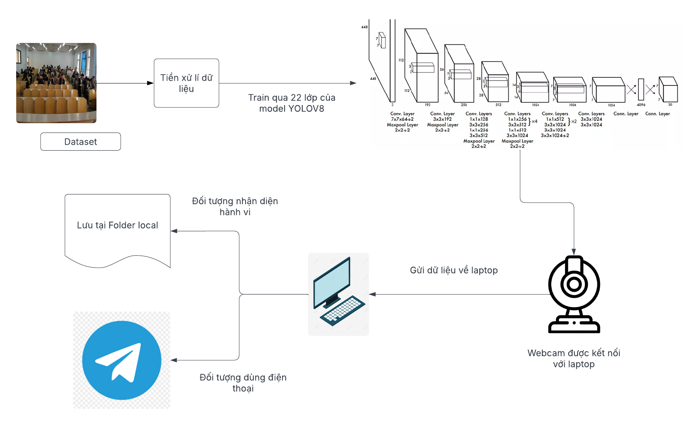
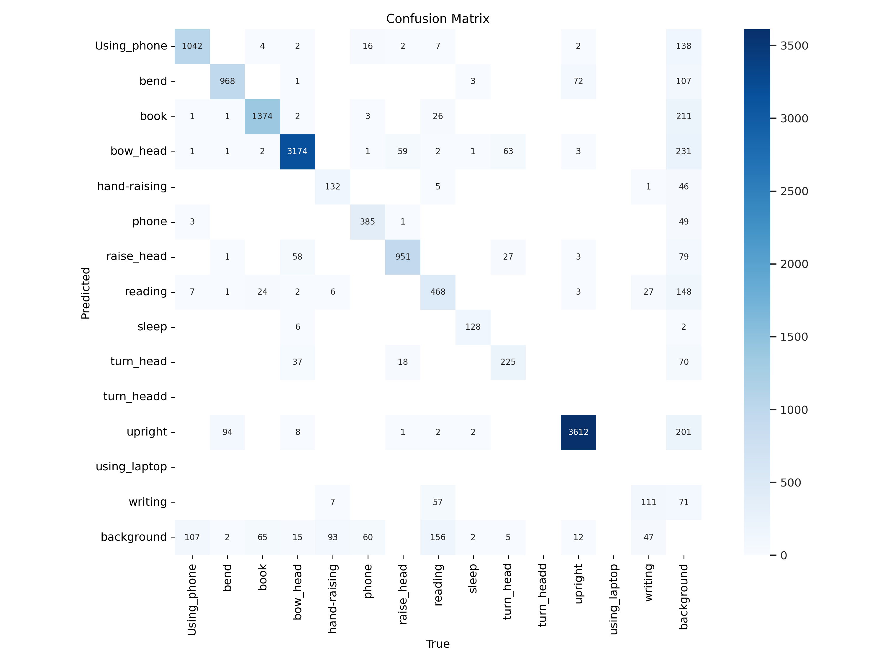
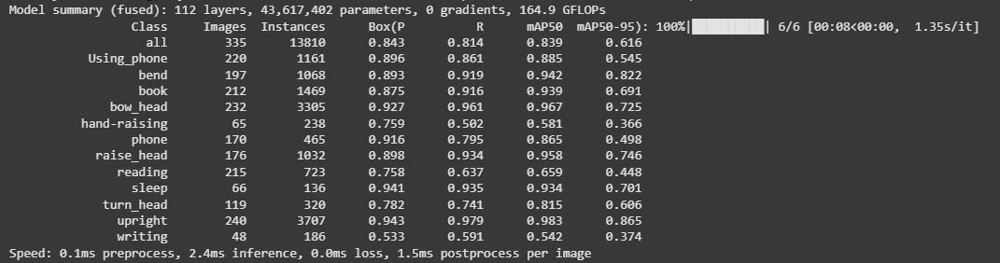

<h1 align="center">NHẬN DIỆN HÀNH VI CỦA SINH VIÊN TRONG LỚP HỌC </h1>

<div align="center">


<h2 align="center">Sử Dụng Yolov8 Để Nhận Diện Hành Vi Của Sinh Viên</h2>

<p align="left">
  Nhận diện hành vi học sinh trong lớp học sử dụng YOLOv8 là ứng dụng công nghệ AI để phát hiện hành vi như giơ tay, sử dụng điện thoại. YOLOv8 giúp nhận diện đối tượng trong ảnh/video theo thời gian thực, hỗ trợ giáo viên quản lý lớp học hiệu quả hơn. Công nghệ này giúp tăng cường sự tương tác và giám sát, nâng cao chất lượng dạy và học.
  Đề tài này sử dụng model YOLOV8 để nhận diện hành vi học sinh với các hành vi như giơ tay, cúi đầu, sử dụng điện thoại/máy tính. YOLOV8 nổi tiếng với chức năng phát hiện đối tượng và phân loại cùng lúc theo thời gian thực, giúp giáo viên quản lý lớp học hiệu quả hơn. Bọn em chọn công nghẹ này để giám sát và hỗ trợ nâng cao năng suất của quá trình giảng dạy.


</p>

---

## 🌟 Kiến trúc hệ thống
<p align="center">
  
</p>

---


## 🛠️ CÔNG NGHỆ SỬ DỤNG

<div align="left">

- **YOLOv8( model m hoặc l)**
- **Google Colab**
- **Thư viện Ultralytics**
- **Python 3.x.x**
</div>

##  Yêu cầu hệ thống

-Có thể sử dụng Visual Studio Code nếu máy có GPU đủ mạnh
<br>
  hoặc là
<br>
-Sử dụng <a href="https://colab.google/" target="_blank">Google Colab</a> hỗ trợ cho dùng miễn phí GPU để train model.

## 🚀 Hướng dẫn cài đặt và chạy


## 🚀 Hướng dẫn cài đặt và chạy mô hình YOLOv8

### Bước 1: Thu thập dữ liệu
Sử dụng dataset đã được gán nhãn sẵn tại môi trường Trường Đại học Đại Nam:

[👉 Link Dataset](https://universe.roboflow.com/ttnt-nyz2m/ai-fxy4m/dataset/2)

### Bước 2: Sử dụng Google Colab để Train mô hình
Truy cập vào Google Colab để thực hiện huấn luyện mô hình YOLOv8.

*Lưu ý: Nên sử dụng Colab Pro để huấn luyện mô hình nặng hơn.*

```python
from google.colab import drive
drive.mount('/content/drive')
```

### Bước 3: Cài đặt các thư viện cần thiết
Cài đặt thư viện và Ultralytics bằng câu lệnh sau:

```bash
!pip install ultralytics
```

### Bước 4: Huấn luyện mô hình
Sử dụng lệnh dưới đây để huấn luyện mô hình YOLOv8:

```bash
!python /content/yolov8/train.py \
    --data "/content/drive/MyDrive/BTL_AII/AI.v3-ai.yolov8pytorch/data.yaml" \
    --cfg "/content/yolov8/cfg/training/yolov8.yaml" \
    --weights "/content/SCB-dataset/yolov8/yolov8.pt" \
    --epochs 50 \
    --batch-size 16 \
    --img-size 640 \
    --device 0 \
    --workers 4 \
    --cache-images \
    --name Yolo7_BTL \
    --project "/content/drive/MyDrive/BTL_AII"
```
*Lưu ý: Chỉnh lại các tham số batch-size, workers phù hợp với cấu hình GPU.*

### Bước 5: Tạo bot Telegram để nhận thông báo
Mở Telegram, tìm @BotFather.
Gửi lệnh /start, sau đó gửi /newbot.
Làm theo hướng dẫn để đặt tên bot và nhận Bot Token (ví dụ: 123456:ABC-DEF1234ghIkl-zyx57W2v1u123ew11).
Gửi một tin nhắn bất kỳ đến bot của bạn (ví dụ: "Hello").
Truy cập URL sau trong trình duyệt: , thay YOUR_BOT_TOKEN bằng token của bạn
```python
https://api.telegram.org/botYOUR_BOT_TOKEN/getUpdates
```
Tìm chat_id trong JSON trả về (ví dụ: 123456789).


### Bước 6: Nhận diện hành vi qua video
Download best.pt từ file weights của file kết quả train, rồi tạo file python để
chạy mô hình YOLOv8 để nhận diện hành vi trong video sử dụng webcam laptop với đoạn mã sau:

```python
import cv2
import os
import time
from ultralytics import YOLO
import requests

# Thông tin Telegram Bot
BOT_TOKEN = ''  # Thay bằng token của bạn
CHAT_ID = ''       # Thay bằng chat ID của bạn
TELEGRAM_API_URL = f'https://api.telegram.org/bot{BOT_TOKEN}/sendPhoto'

# Load your custom YOLOv8 model
model = YOLO('D:/aiot/models/best (2).pt')  # Đường dẫn đến model của bạn

# Create the 'detected_frames' directory if it doesn't exist
output_folder = 'usingphone'
if not os.path.exists(output_folder):
    os.makedirs(output_folder)

# Open webcam
cap = cv2.VideoCapture(0)
if not cap.isOpened():
    print("Error: Could not open webcam.")
    exit()

frame_count = 0
last_save_time = 0
last_notify_time = 0  # Thời điểm gửi thông báo cuối cùng

def send_telegram_notification(image_path, class_name):
    """Gửi ảnh và thông báo qua Telegram"""
    with open(image_path, 'rb') as photo:
        message = f"Phát hiện: {class_name}"
        files = {'photo': photo}
        data = {
            'chat_id': CHAT_ID,
            'caption': message
        }
        response = requests.post(TELEGRAM_API_URL, files=files, data=data)
        if response.status_code == 200:
            print(f"Đã gửi thông báo Telegram: {message}")
        else:
            print(f"Lỗi gửi thông báo Telegram: {response.text}")

while True:
    ret, frame = cap.read()
    if not ret:
        print("Error: Could not read frame from webcam.")
        break

    # Perform object detection
    results = model(frame)

    # Kiểm tra nếu có phát hiện đối tượng
    if len(results) > 0:
        result = results[0]
        if len(result.boxes) > 0:
            # Lấy danh sách tên lớp của các đối tượng được phát hiện
            class_ids = result.boxes.cls.cpu().numpy()
            class_names = [result.names[int(cls_id)] for cls_id in class_ids]
            annotated_frame = result.plot()  # Vẽ bounding boxes lên frame

            # Kiểm tra nếu có nhãn "Using_phone"
            if "Using_phone" in class_names:
                current_time = time.time()
                # Lưu ảnh nếu đã qua 1 giây
                if current_time - last_save_time >= 1:
                    frame_filename = os.path.join(output_folder, f'frame_{frame_count:04d}.jpg')
                    cv2.imwrite(frame_filename, annotated_frame)
                    print(f"Đã lưu ảnh: {frame_filename}")
                    last_save_time = current_time
                    frame_count += 1

                    # Gửi thông báo Telegram nếu đã qua 5 giây
                    if current_time - last_notify_time >= 5:
                        send_telegram_notification(frame_filename, "Using_phone")
                        last_notify_time = current_time
        else:
            annotated_frame = frame
    else:
        annotated_frame = frame

    # Hiển thị frame
    cv2.imshow('Live Stream Object Detection', annotated_frame)

    # Thoát khi nhấn 'q'
    if cv2.waitKey(1) & 0xFF == ord('q'):
        break

# Giải phóng tài nguyên
cap.release()
cv2.destroyAllWindows()
```
Sau đó các frame nhận diện được bởi mô hình sẽ được lưu vào folder detected_frames, và các hành vi dùng điện thoại sẽ được gửi qua Telegram


## Kết quả train model
Ma trận nhầm lẫn
<p align="center">
  
</p>
<br>
Độ chính xác trung bình của các nhãn
<p align="center">
  
</p>
## 🤝 Đóng góp
Dự án được phát triển bởi 3 thành viên:

| Họ và Tên                | Vai trò                  |
|--------------------------|--------------------------|
| Võ Vĩnh Thái             | Phát triển toàn bộ mã nguồn,kiểm thử, triển khai dự án, thuyết trình, đề xuất cải tiến.|
| Lê Ngọc Hưng            | Thực hiện video giới thiệu|
| Phạm Tiến Dũng   | Viết báo cáo.  |

© 2025 NHÓM 2, CNTT 16-01, TRƯỜNG ĐẠI HỌC ĐẠI NAM
